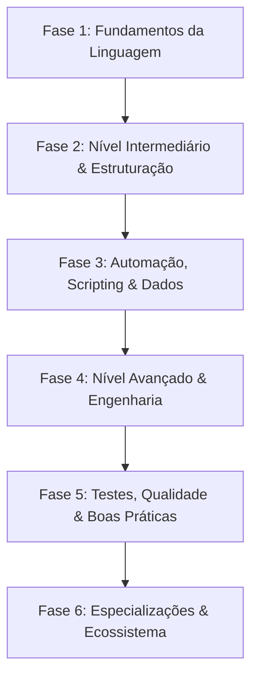

# 🗺️ Roadmap de Estudos em Python

Este roadmap foi desenvolvido para guiar uma jornada completa de aprendizado prático em Python, partindo dos fundamentos essenciais até conceitos avançados de engenharia de software e automação.

Cada tópico pode ser acompanhado marcando as caixas de seleção (`[x]`) conforme for dominado e praticado com scripts na pasta `examples/`.

---

## 🧭 Visão Geral da Trilha



---

## 📍 Fase 1: Fundamentos da Linguagem

O objetivo desta fase é dominar a sintaxe básica, o fluxo de execução e a resolução de problemas algorítmicos essenciais.

- [ ] **Ambiente & Execução**
  - [ ] Instalação e verificação de versões do Python (`python --version`)
  - [ ] Uso do REPL / interpretador interativo
  - [ ] Execução de scripts via terminal (`python script.py`)
  - [ ] Configuração e uso de ambientes virtuais (`venv`)
- [ ] **Tipos de Dados Primitivos & Operadores**
  - [ ] Inteiros (`int`), Decimais (`float`), Textos (`str`), Booleanos (`bool`)
  - [ ] Operadores aritméticos (`+`, `-`, `*`, `/`, `//`, `%`, `**`)
  - [ ] Operadores de comparação (`==`, `!=`, `>`, `<`, `>=`, `<=`)
  - [ ] Operadores lógicos (`and`, `or`, `not`)
  - [ ] Precedência de operadores
- [ ] **Manipulação de Strings**
  - [ ] Concatenação, interpolação e f-strings (`f"Olá, {nome}"`)
  - [ ] Métodos principais: `.lower()`, `.upper()`, `.strip()`, `.replace()`, `.split()`, `.join()`
  - [ ] Fatiamento de strings (slicing: `texto[inicio:fim:passo]`)
- [ ] **Estruturas de Controle de Fluxo**
  - [ ] Condicionais: `if`, `elif`, `else`
  - [ ] Expressão condicional ternária (`valor_se if cond else valor_senao`)
  - [ ] Pattern Matching estrutural (`match` / `case` - Python 3.10+)
- [ ] **Laços de Repetição**
  - [ ] Laço `for` e função `range()`
  - [ ] Laço `while`
  - [ ] Controle de loop: `break`, `continue` e cláusula `else` em laços
  - [ ] Funções auxiliares de iteração: `enumerate()` e `zip()`
- [ ] **Funções Básicas**
  - [ ] Declaração com `def`, retorno com `return`
  - [ ] Parâmetros posicionais vs nomeados (keyword arguments)
  - [ ] Valores padrão para argumentos
  - [ ] Escopo de variáveis (local vs global)
  - [ ] Docstrings básicas para documentação de funções
- [ ] **Entrada/Saída (I/O) Simples**
  - [ ] Interação com usuário via `input()` e formatação com `print()`
  - [ ] Leitura e escrita de arquivos de texto (`open()`, `with open(...) as f:`)
  - [ ] Uso moderno de caminhos com `pathlib.Path`

> 🎯 **Desafio Prático sugerido:** Criar um gerador de senhas aleatórias configurável ou um analisador de arquivos de log em formato texto.

---

## 📍 Fase 2: Nível Intermediário & Estruturação

Aprofundamento nas estruturas de dados nativas, tratamento defensivo de erros e organização modular do código.

- [ ] **Estruturas de Dados Nativas**
  - [ ] **Listas (`list`):** Métodos `.append()`, `.extend()`, `.pop()`, `.remove()`, `.sort()`, indexação e slicing
  - [ ] **Tuplas (`tuple`):** Imutabilidade, desempacotamento de tuplas (*tuple unpacking*)
  - [ ] **Dicionários (`dict`):** Pares chave-valor, `.get()`, `.keys()`, `.values()`, `.items()`, `.update()`
  - [ ] **Conjuntos (`set`):** Elementos únicos, operações de união, interseção, diferença e testes de pertinência (`in`)
  - [ ] Módulo `collections`: `Counter`, `defaultdict`, `namedtuple`, `deque`
- [ ] **Comprehensions & Expressões Geradoras**
  - [ ] List Comprehensions (`[x*2 for x in lista if x > 0]`)
  - [ ] Dict Comprehensions (`{k: v for k, v in pares}`)
  - [ ] Set Comprehensions
  - [ ] Generator Expressions com parênteses (economia de memória)
- [ ] **Tratamento de Exceções & Erros**
  - [ ] Blocos `try`, `except Exception as e`, `else`, `finally`
  - [ ] Lançamento explícito de exceções com `raise`
  - [ ] Criação de exceções customizadas herdando de `Exception`
  - [ ] Captura de múltiplas exceções e boas práticas (nunca usar `except:` puro)
- [ ] **Funções Avançadas & Funcional**
  - [ ] Empacotamento/desempacotamento flexível: `*args` e `**kwargs`
  - [ ] Parâmetros apenas posicionais (`/`) e apenas nomeados (`*`)
  - [ ] Funções lambda anônimas
  - [ ] Funções de ordem superior: `map()`, `filter()`, `sorted()` com chave (`key=lambda ...`)
- [ ] **Modularização & Pacotes**
  - [ ] Importação de módulos (`import`, `from ... import ...`, aliases com `as`)
  - [ ] Organização de pacotes com `__init__.py`
  - [ ] Ponto de entrada padrão: `if __name__ == "__main__":`
  - [ ] Resolução de caminhos de importação e `sys.path`
- [ ] **Gerenciamento de Dependências**
  - [ ] Criação e congelamento de requisitos: `pip freeze > requirements.txt`
  - [ ] Instalação de dependências: `pip install -r requirements.txt`
  - [ ] Introdução ao `pyproject.toml` para empacotamento moderno

> 🎯 **Desafio Prático sugerido:** Desenvolver um gerenciador de tarefas (Todo List) em CLI persistido em formato JSON com tratamento completo de erros.

---

## 📍 Fase 3: Automação, Scripting & Dados

Aplicação prática de Python no mundo real: manipulação de arquivos de produtividade, integração com APIs e automação de rotinas.

- [ ] **Manipulação de Arquivos Estruturados**
  - [ ] Arquivos **CSV**: Leitura e escrita com módulo nativo `csv` (`csv.reader`, `csv.DictWriter`)
  - [ ] Arquivos **JSON**: Serialização e desserialização (`json.dump()`, `json.load()`, `json.dumps()`, `json.loads()`)
  - [ ] Arquivos **Excel (`.xlsx`)**: Criação, estilização, validação e fórmulas com `openpyxl` *(Exemplo implementado em `examples/generate-excel.py`)*
  - [ ] Manipulação de arquivos **PDF**: Leitura e extração com `pypdf` ou `pdfplumber`
- [ ] **Automação de Sistema de Arquivos & OS**
  - [ ] Módulo `pathlib`: Navegação, criação de pastas, globbing (`Path.glob()`)
  - [ ] Módulos `os` e `shutil`: Cópia, movimentação, exclusão segura e listagem de diretórios
  - [ ] Módulo `subprocess`: Execução de comandos do sistema operacional
  - [ ] Leitura de variáveis de ambiente com `os.environ` e `python-dotenv`
- [ ] **Consumo de APIs REST**
  - [ ] Biblioteca `requests` / `httpx`: Métodos `GET`, `POST`, `PUT`, `DELETE`
  - [ ] Envio e recebimento de parâmetros de query, headers e payload JSON
  - [ ] Tratamento de status codes HTTP e timeouts
  - [ ] Autenticação simples (API Keys, Bearer Tokens)
- [ ] **Web Scraping Básico**
  - [ ] Requisições com `requests` e parsing de HTML com `BeautifulSoup` (`bs4`)
  - [ ] Localização de elementos por tags, classes CSS e atributos
  - [ ] Boas práticas éticas de scraping (robots.txt, delays/rate limiting)
- [ ] **Interfaces de Linha de Comando (CLI)**
  - [ ] Parsing de argumentos via terminal com `argparse` nativo
  - [ ] Criação de comandos amigáveis com `typer` ou `click`

> 🎯 **Desafio Prático sugerido:** Criar um script que consulta cotações de moedas ou clima em uma API pública e gera uma planilha Excel formatada com histórico.

---

## 📍 Fase 4: Nível Avançado & Engenharia de Software

Padrões de projeto, programação orientada a objetos aprofundada, metaprogramação e programação concorrente.

- [ ] **Programação Orientada a Objetos (POO)**
  - [ ] Classes, instâncias, atributos de instância vs atributos de classe
  - [ ] Métodos normais, `@classmethod` e `@staticmethod`
  - [ ] Propriedades e encapsulamento com `@property` e setters
  - [ ] Métodos mágicos / Dunder methods (`__init__`, `__str__`, `__repr__`, `__eq__`, `__len__`, `__getitem__`)
  - [ ] Herança simples, herança múltipla e ordem de resolução de métodos (`MRO`)
  - [ ] Classes abstratas com `abc.ABC` e `@abstractmethod`
  - [ ] Uso de `@dataclass` para modelos de dados limpos (Python 3.7+)
- [ ] **Type Hinting Estrito (Tipagem Estática)**
  - [ ] Anotações em parâmetros e retornos (`def soma(a: int, b: int) -> int:`)
  - [ ] Módulo `typing`: `Optional`, `Union`, `List`, `Dict`, `Any`, `Callable`, `Literal`
  - [ ] Novas sintaxes de união com pipe: `str | None` (Python 3.10+)
  - [ ] Validação estática de tipos com `mypy` ou `pyright`
- [ ] **Decorators & Closures**
  - [ ] Conceito de funções como cidadãos de primeira classe (*first-class citizens*)
  - [ ] Closures e escopo não-local (`nonlocal`)
  - [ ] Criação de decoradores com `functools.wraps`
  - [ ] Decoradores com argumentos e decoradores de classe
- [ ] **Iteradores & Geradores**
  - [ ] Protocolo de Iteração (`__iter__` e `__next__`)
  - [ ] Funções geradoras com palavra-chave `yield`
  - [ ] Módulo `itertools`: `chain`, `cycle`, `combinations`, `islice`
- [ ] **Context Managers (Gerenciadores de Contexto)**
  - [ ] Implementação de classes de contexto com `__enter__` e `__exit__`
  - [ ] Criação rápida com geradores via `@contextmanager` do módulo `contextlib`
- [ ] **Concorrência & Assincronia**
  - [ ] Diferença entre I/O Bound vs CPU Bound
  - [ ] Programação Assíncrona com `asyncio`: palavras-chave `async` e `await`
  - [ ] Criação de tarefas assíncronas concorrentes (`asyncio.gather()`, `asyncio.TaskGroup`)
  - [ ] Noções de `threading` (threads) e `multiprocessing` (processos)

> 🎯 **Desafio Prático sugerido:** Desenvolver um downloader de arquivos/dados assíncrono que processa múltiplos links simultaneamente e loga o tempo de resposta.

---

## 📍 Fase 5: Qualidade de Código, Testes & Boas Práticas

Ferramentas e disciplinas que diferenciam scripts amadores de software profissional e manutenível.

- [ ] **Padrões de Estilo & Formatação (PEP 8)**
  - [ ] Convenções de nomes (snake_case, PascalCase, UPPER_CASE)
  - [ ] Uso de formatadores automáticos: `ruff format` ou `black`
  - [ ] Linters para análise estática: `ruff check` ou `flake8`
  - [ ] Organização de imports com `isort`
- [ ] **Testes Automatizados com `pytest`**
  - [ ] Estruturação de testes na pasta `tests/`
  - [ ] Assertivas simples (`assert resultado == esperado`)
  - [ ] Uso de fixtures para preparação de estado (`@pytest.fixture`)
  - [ ] Testes parametrizados (`@pytest.mark.parametrize`)
  - [ ] Criação de mocks e simulação de chamadas externas (`unittest.mock`)
  - [ ] Medição de cobertura de código com `pytest-cov`
- [ ] **Logging Profissional**
  - [ ] Módulo nativo `logging` (substituição do `print`)
  - [ ] Níveis de log: `DEBUG`, `INFO`, `WARNING`, `ERROR`, `CRITICAL`
  - [ ] Configuração de formatters e handlers (saída no console + arquivo `.log`)
- [ ] **Gerenciamento de Configuração & Validação**
  - [ ] Separação de segredos e credenciais via variáveis de ambiente
  - [ ] Validação de dados e configurações com `pydantic`
- [ ] **Integração Contínua (CI)**
  - [ ] Configuração de pipeline simples com GitHub Actions para rodar linter e testes a cada `git push`

> 🎯 **Desafio Prático sugerido:** Adicionar uma suíte de testes com `pytest` e checagem com `ruff` para um dos scripts da pasta `examples/`.

---

## 📍 Fase 6: Especializações & Próximos Passos

Trilhas eletivas para expandir os estudos de acordo com o interesse profissional:

```text
├── 🌐 Back-end & Web APIs     -> FastAPI, Pydantic, SQLAlchemy, PostgreSQL, Docker
├── 📊 Análise de Dados / BI   -> Pandas, NumPy, Matplotlib, Seaborn, DuckDB, Polars
├── 🤖 IA & Automação de LLMs  -> APIs Gemini / OpenAI, LangChain, Agentes Autônomos
└── ⚙️ Automação Web Avançada   -> Playwright, Selenium
```

---

## 📚 Recursos & Documentação Recomendada

- [Documentação Oficial do Python (Português)](https://docs.python.org/pt-br/3/)
- [Guia de Estilo PEP 8](https://peps.python.org/pep-0008/)
- [Real Python (Artigos e Tutoriais Práticos)](https://realpython.com/)
- [Python Morsels (Dicas e Exercícios Idiomáticos)](https://www.pythonmorsels.com/)
